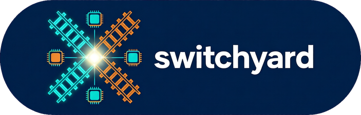

# switchyard



> **Prototype, 0.1.x.** switchyard is advisory only: it suggests a model, engine and device, and it never serves traffic. Every number in it was measured on one rig (Intel Core Ultra 9 285K with its NPU and iGPU, plus an RTX 5090). Treat its routes as that rig's evidence, not a general benchmark.

A rail switchyard sends each car onto the right track. This one sends each job to a model, an engine and a device.

You give it a task (embed, rerank, NLI, verify, generate) and the constraints that matter (quality, latency, context, thinking level). It answers with a model, an engine, a device and the settings, and it shows the receipt behind every number. OpenVINO's AUTO and HETERO plugins can pick a device once you have already picked the model. Nothing in that stack picks the model. That gap is the product.

What this program is allowed to touch is in the [threat model](#threat-model).

The receipt schema, the routing table, and the harness came first. `switchyard route` reads that table. It does not spend device time.

## What the table says today

The routing table holds 502 rows from committed receipts. A few of the answers it already gives:

- **A small model runs well on the Intel side.** Phi-3.5-mini decodes at about 20–22 tokens/s on the CPU and the iGPU, and about 15 tokens/s on the NPU, at a 1024-token prompt with thinking off. That leaves the 5090 free for bigger work.
- **An 8B model doesn't belong on the Intel side.** At the same 1024-token prompt with thinking off, Qwen3-8B decodes at about 10–12 tokens/s on the CPU, iGPU and NPU. On the 5090 it decodes at about 208 tokens/s with thinking off and 211 with it on. Ask for 15 tokens/s with the 5090 busy, and the router refuses and names the experiment behind the gap: `switchyard route --task generate --model qwen3-8b --min-tok-s 15 --busy 5090`.
- **Some shapes don't run at all.** The NPU rejected Qwen3-Embedding at 512-token inputs, both one at a time and in batches of 8. Those rows are kept as capability findings, never ranked as slow candidates.

Those figures are the decode rates recorded in the E3 and e3-ref receipts. The run notes are in [experiments/e3/run-notes-2026-10-10-11.md](experiments/e3/run-notes-2026-10-10-11.md). `switchyard route` ranks by the worst repeat, not the median, so its choices are more cautious than these summaries.

## What it will not do

switchyard does not serve traffic and it does not proxy requests. It does not train models. It does not edit offrig, npu-serve or rnd. Those stay with their owners. A serving layer needs its own brief.

## Devices

Every device is named.

| Name | What it is |
|---|---|
| `NPU` | Intel AI Boost on the Core Ultra 9 285K |
| `iGPU` | The Intel GPU. A live enumeration must say vendor `0x8086` and device type `INTEGRATED`. The full name is recorded, not the decision |
| `CPU` | The same processor's CPU |
| `5090` | The RTX 5090, reached only through Ollama at `127.0.0.1:11434` |

`GPU.1` is the 5090 as OpenVINO sees it on this rig. The resolver refuses that index even if the name or the vendor changes, refuses a bare `GPU`, refuses `AUTO`, `HETERO` and `MULTI`, and refuses a GPU that is not vendor `0x8086` and `INTEGRATED`. A list with neither device property still requires the full name to contain "Intel". A missing device is an error. switchyard does not fall off onto a weaker one.

The NPU is exclusive. A 5090 step runs only inside a Publisher grant. The runner records that grant. CPU-heavy legs wait for a window the Publisher announces.

## Receipts

A routing row names the task, the model (repo or tag, revision or digest, quantisation, licence), the engine and its version, the device, the settings, and the quality and latency it measured. Quality metrics carry their own `n`, interval and dataset hash. Latency keeps cold and warm apart. A single run is marked provisional. The row points at the source receipt and the commit it was imported from, or at an experiment spec and a run id.

A run can also record a capability row instead of a speed. `device_lost` and `hang` carry no timing. `native_binary_rejected` — the device compiled the model and refused the native binary at execute — keeps only the compile time as evidence, and is scoped to the model, device and static shape: only arms with that identical key are marked not run, and the device's other shapes still run. All three are provisional and never count as speeds. An arm that an abort stopped mid-schedule is kept in its receipt marked `aborted: true`, with the slots actually completed; the routing table refuses aborted rows, and `table/gaps.md` lists the aborted run. A watcher thread guards every run from outside the main thread: a native compile that runs past `compile_ceiling_s` (default 900 s) is recorded as a `compile_timeout` capability row, and system RAM at 88% aborts the run; both flush the receipt first and end the process with exit code 75 (compile timeout) or 76 (RAM stop). Every run also writes `receipts/<run_id>.run.json` before it touches a device (git-ignored, not a receipt), so a run killed from outside still leaves a record that it started. To stop a run cleanly from outside, create `receipts/<run_id>.stop`: the watcher flushes the receipt and exits with code 77.

```
switchyard check
```

That validates every receipt under `receipts/` and `table/routing.jsonl`. An empty tree is fine. A home-directory path in a receipt is not.

## Threat model

switchyard touches local devices and local HTTP, and the network only to download a model that an experiment spec already named, from that model's publisher.

- Receipts and the routing table are local files.
- Ollama calls, when a run is actually started, go to `127.0.0.1:11434` (the 5090) or `127.0.0.1:11490` (CPU). Cloud model tags are refused.
- OpenVINO runs, when a run is actually started, use `NPU`, `CPU`, or the Intel iGPU (vendor `0x8086` and `INTEGRATED`). They never select `GPU.1`.
- A 5090 step without `--grant` does not start. An NPU or iGPU step without `--npu-session` does not start.
- The 5090 path checks that the VRAM watchdog heartbeat is at most 60 seconds old and that no model is loaded. The heartbeat file is not opened. Only its modified time is read.
- Nothing here listens on a port.
- switchyard does not rent a GPU, set a spending cap, or open offrig's database. A remote price enters only as a dated snapshot file.

## Layout

`devices` is the allow-list. `guards` is the grant, the session, the heartbeat and the empty card. `receipt` is the schema and `switchyard check`. `importers` rebuilds `table/routing.jsonl` from pinned receipts. `switchyard table` prints that table, filtered by task or device. `table/gaps.md` is the experiment backlog. The harness runs a committed spec. `switchyard route` reads that table and does not touch a device.

The build brief and the four feedback notes it names are snapshotted in `docs/handoff/`. The copy in the studio memory store stays authoritative.

## Route

`switchyard route` answers from `table/routing.jsonl`. It does not start a device, read a ledger, or call offrig.

```
switchyard route --task generate --model Phi --thinking off --ctx 1024 --busy 5090
```

`--model` matches a substring of the repo or tag. Hyphens and colons are ignored, so `Qwen3-8B` matches `qwen3:8b`. A short substring can match an unintended repo. The matched model is printed. `--thinking off` matches only `off`. `--thinking on` matches any recorded thinking level, and the decision keeps that level, so an OpenVINO `low` arm stays `low`. `low`, `medium` and `high` match exactly when the request names one. `--min-tok-s` is the floor on the minimum repeat-slot decode rate. A refusal names that floor `min_tok_s`. `--budget-left-usd` is an input, like `--busy`. A remote row whose worst case exceeds it is a runner-up. With no flag, a remote suggestion is marked budget unchecked. `--as-of` defaults to today. The policy itself does not read the clock.

Generate ranks by the lowest repeat-slot decode tok/s. Every other task ranks by the highest repeat-slot latency, or by the maximum claim-wall when the row has no repeat slots. The margin is the gap between those conservative bounds, never a median. Ties leave the 5090 free. A row older than 30 days is stale. A row marked provisional, or with fewer than two repeats, is provisional. Both stay eligible and are flagged.

`native_binary_rejected`, `compile_rejected`, `compile_timeout`, `hang`, `device_lost` and a row with `parity_valid` false (`parity_invalid`) are listed under excluded, with those codes. They are not candidates. A capability outcome is the code shown when the row is also parity-invalid. When no row meets the constraints the command exits 1 and names the constraint that emptied the set. It does not fall back. `--json` prints a document valid against `src/switchyard/schema/route-decision.v1.json`. `--max-ttft-ms` refuses unless every compared row records the same `settings.prefix_caching` (`on`, `off`, or `default`). Unset means unknown.

A remote suggestion includes an `offrig_plan` object. switchyard does not call `offrig_plan` or `offrig_launch`, and it does not spend. See `docs/offrig-integration.md`.

## Run an experiment

Every experiment is pre-registered: its spec under `experiments/<id>/spec.yaml` is committed, with the question, the decision it feeds, the arms, the dataset, the metrics and the stop rules, before any device time. `switchyard run` refuses a spec that was edited after its commit, and records the spec's blob in the receipt. By practice, a rule is not changed after results are seen; a dated amendment comes before the run whose results count, and a run set aside as void is recorded as such.

```
switchyard run experiments/e4/spec.yaml --dry-run
switchyard run experiments/e4/spec.yaml --grant "<grant text>" --npu-session "<session>"
```

`--dry-run` prints the plan and the guards a real run would need, and starts nothing. A real run needs the flags its devices call for: `--grant` for the 5090, `--npu-session` for the NPU or iGPU, and `--cpu-window` for a CPU-heavy leg. It writes one receipt under `receipts/`. `switchyard import` then rebuilds `table/` from the committed receipts, and `switchyard check` validates them.

## When Ollama hangs

`switchyard ollama-health` asks `GET /api/version` on `127.0.0.1:11434` (the 5090 server) and `127.0.0.1:11490` (the CPU-only server). A port is healthy when that answer arrives within 5 seconds. The command prints one line per port and exits 1 if either is down.

A real `switchyard run` restarts Ollama only on `127.0.0.1:11434`, only between steps, and only after a step failed with a transport error, a timeout that is a real hang, or a 5xx while that server is down. Down means three failed health checks, two seconds apart. A request that passed its own deadline is a hang only when health then fails, or `/api/ps` does not show the model making progress. A long prompt whose version still answers, and whose model is still listed, is not a hang. A 118k-token prompt is not killed for being slow.

Port `11490` is offrig's CPU indexer. Health still reports it. A down `11490` stops the run. switchyard never stops that process, and no grant covers a restart of it.

Immediately before anything is stopped, the restart re-checks the `--grant`, the watchdog heartbeat, and `/api/ps`. A listing that names a model from another session is refused. An unreadable `/api/ps` does not, by itself, block a restart of a server that is already down. During a hang, health can still answer. An unreadable `/api/ps` then refuses the restart, because another session's model would be dropped without being seen.

The process that is stopped is the one listening on `11434`. Nothing is killed by name. The tray app stays up unless it is that listener. `ollama serve` is replayed from the start line recorded for this run: the argv, every `OLLAMA_*` and `LLAMA_ARG_*` variable, and the log file. Stdout and stderr are appended to that log. switchyard does not sign in. There is no `OLLAMA_CUDA_BACKEND` variable. If a backend has to be forced, the variable is `OLLAMA_LLM_LIBRARY`, and it belongs in the recorded start line.

The record is a JSON file named by `SWITCHYARD_OLLAMA_SERVE`. The fields are `argv`, `env`, `log_path`, `library_path`, `ggml_cuda_sha256`, and `backend_line`. One recorded start on this rig is `cmd /c ollama serve` with `OLLAMA_HOST=127.0.0.1:11434` and `OLLAMA_MODELS=E:/AI-Models/Ollama`, logging to `E:/AI/ollama-cu134/system-11434.log`. The loaded library is `%LOCALAPPDATA%\Programs\Ollama\lib\ollama\cuda_v13\ggml-cuda.dll`. The publisher's sha256 of that file starts `6d3128e946bc9c95`. A run records the start line it was given and replays that one. A missing record refuses the restart before anything is stopped.

At the start of a run the record's full `OLLAMA_*` and `LLAMA_ARG_*` set is compared with the live process environment. That comparison is exact. When the process environment cannot be read, the server's `server config` log line is the fallback, and that comparison is exact too: a record that is only part of the logged defaults disables restarts. A mismatch means this run makes no restarts. The reason is written on the run marker as `ollama_restart_disabled`. Nothing is stopped. `OLLAMA_HOST` matches with or without an `http://` or `https://` scheme.

After the server is back, the run reads the library sha256 from `library_path`. Flash attention, the KV cache type, the `load_backend` line, and the full `OLLAMA_*` and `LLAMA_ARG_*` set are read from the log bytes written after the spawn. The bytes before that offset are the previous server, and a line there is not a match. If the log's size cannot be read, that offset is unknown and the run stops. A missing log is empty, and its offset is zero. A `load_backend` line that has not been written yet is checked after the first model load, and before that sample is kept. A missing or different line stops the run. The new segment's server config line has to cover every variable the run was measured under. Defaults the process did not set may also be logged. A server that comes back on a different library, or under a different environment, stops the run. The driver CUDA version from `nvidia-smi` is not the check: a restart cannot change it. Flash attention and the KV cache type that the log does not echo fail the match. They are not copied forward from the record and called a read.

If the server is not healthy within 60 seconds, or the card is not back at its baseline, the run stops and says a person has to start Ollama. At most two restarts a run. A failed restart counts against that cap.

Each restart is written on the run marker and on `settings.ollama_restarts`: when, which port, why (`down` or `hung`), the old and new pids, the time to healthy, and the version. The step that was in flight is inconclusive, never a pass. It is tried again only when the spec sets `retry` (the default is none). A kept retry sets `settings.retried`. The first kept sample after a restart sets `settings.cold_after_restart` and stays out of the warm percentiles. A measurement taken across a restart is not kept.

`--dry-run` prints this policy and does not contact either port.

## Develop

The environment is its own, at `E:/AI/envs/switchyard`, Python 3.12. It does not share the NPU environment. OpenVINO 2026.4.1 is the `intel` extra, pinned to the same versions as that environment. Tests do not need it.

```
uv sync --frozen
uv run switchyard check
uv run pytest
```
